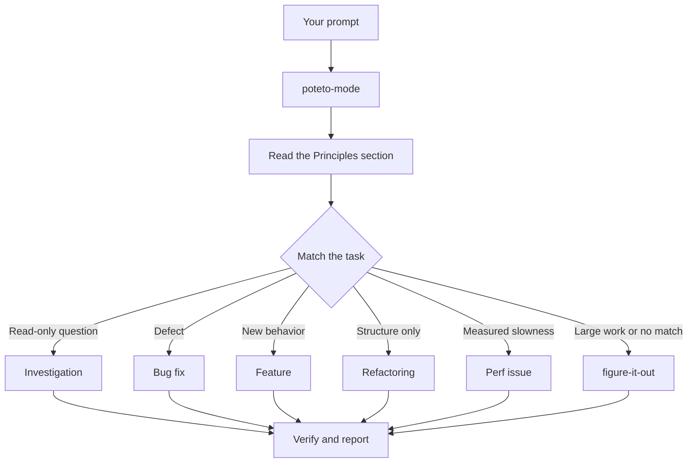

# `/poteto-mode`를 통한 작업 라우팅

`/poteto-mode`는 정문입니다. 목표를 주면, 23개의 플레이북 중 하나에 매칭하고, 그 플레이북의 단계를 todo 리스트에 복사하고, 단계가 필요할 때 다른 스킬들을 호출합니다. 이 페이지에서는 좋은 프롬프트가 어떻게 보이는지, 그리고 실제로 얼마나 적게 필요한지 배웁니다.


## 프롬프트에 무슨 일이 일어나는가



다이어그램은 일반적인 경로를 보여줍니다. 메트릭을 hillclimbing하고, 런타임 증상과 캡처된 트레이스를 진단하고, 프로토타입, 시각적 패리티, 스킬 작성 및 평가, 자율 실행, PR 열기, PR 또는 스택을 병합 준비 상태로 babysit하기, 검증된 스택 배포하기, PR 큐 또는 스택을 autopilot에서 실행, 프로젝트 규모 프로그램 조율, 세션 픽업, 안전하게 일시 중지, 다단계 계획, 워크트리 정리를 위한 플레이북도 있습니다. [플레이북 디렉토리](../../skills/poteto-mode/playbooks/)에 전체 세트가 있습니다.

## 목표를 말하고, 의식을 말하지 마세요

스펙을 작성하지 않습니다. 무엇이 잘못되었는지 또는 무엇을 원하는지 말하고, 에이전트 시간을 절약하는 이미 알고 있는 것을 추가하세요:

```text
/poteto-mode users get two notifications after a retry. repro first, then fix and verify.
```

그것은 Bug fix 프롬프트입니다. "repro first"는 정중함이 아니라 실제 제약이며, 플레이북이 그것을 존중합니다. Bug fix 단계로 todo 리스트가 채워지는 것을 관찰하세요. 건너뛴 단계는 `skip: <reason>`과 함께 보이게 유지됩니다.

## 프롬프트에 들어가는 것

유용한 프롬프트는 최대 다섯 가지를 포함하며, 각각은 한 문장에 맞습니다:

- **목표.** 무엇이 잘못되었는지 또는 무엇을 원하는지 말하세요.
- **완료 체크.** 통과하거나 실패할 수 있어야 합니다. "더 좋게 만들기"와 "한 시간 동안 작업하기"는 체크가 아닙니다.
- **보고 싶은 증거.** 실제 명령 출력, 플로우의 비디오, 저장된 값, 또는 전후 숫자를 요청하세요.
- **이미 알고 있는 것.** 증상, 재현 단계, 로그 라인 또는 링크는 에이전트의 검색을 절약합니다.
- **실제 제약.** "repro first", "don't change any code yet", "zero behavior change", "let me review before proceeding"은 각각 에이전트가 하는 것을 변경합니다.

다섯 가지 모두를 가진 하나의 프롬프트입니다:

```text
/poteto-mode the csv export drops its last row since yesterday's deploy. failing job id is 4812. repro first, then fix. done means the 60k-row fixture exports every row. show me the row counts before and after.
```

생략할 가치가 있는 두 가지:

- **방법.** 달성할 것을 말하고, 에이전트에게 당신이 선택할 것보다 더 나은 경로를 찾을 여지를 남기세요. 스킬 목록에 대해서도 마찬가지이며, 아래 함정에서 다룹니다.
- **처음에는 원인에 대한 당신의 이론.** 명시된 추측은 당신이 가리킨 곳으로 검색을 좁힙니다. 당신의 직감을 공유하기 전에 에이전트가 문제를 다시 말하도록 하세요.

긴 스레드나 모호한 버그와 같은 시끄러운 보고의 경우, 재진술을 첫 번째 단계로 만드세요:

```text
/poteto-mode read this thread. restate the underlying issue in your own words, in plain english. don't change any code yet.
```

잘못 읽은 것은 코드가 존재하기 전에 재진술에 나타납니다. 거기서 수정하면, 잘못된 수정 하나 대신 하나의 메시지 비용입니다. 플레이북 없이 재진술만 원하면 [`/in-your-own-words`](../../skills/in-your-own-words/SKILL.md)를 실행하세요. 에이전트가 생각하는 당신의 목표와 해결하려는 문제가 무엇인지 다시 말합니다.

프롬프트가 올바르게 겨냥되었는지 확실하지 않을 때, 보내기 전에 [`/sharpen`](../../skills/sharpen/SKILL.md)을 실행하세요:

```text
/sharpen write a migration guide for the v2 config format.
```

에이전트는 당신이 요청하지 않은 것을 최고의 전문가가 할 것, 그들이 시작할 가장 원시적인 자료, 그들이 사용할 방법과 도구, 그리고 당신이나 에이전트가 아닌 무엇이 결과가 옳다는 것을 보여줄지 말합니다. 그런 다음 정확히 그것을 요청하도록 프롬프트를 재작성하며, 더 깊지만 더 크지 않고, 선택권을 열어둡니다. 작업을 수행하지 않습니다. 재작성을 읽고, 예를 들어 `/poteto-mode`로 보내세요.

## 짧게 후속 조치

대화가 이미 컨텍스트를 포함할 때, 프롬프트는 거의 아무것도 아니게 줄어듭니다. 이것들은 모두 충분합니다:

```text
/poteto-mode do it
```

```text
continue
```

```text
keep going until done
```

짧게 작동하는 이유는 플레이북이 구조를 보유하고, 커스텀 모드가 매 턴마다 `/poteto-mode`를 컨텍스트에 유지하기 때문입니다. [pstack 설정하기](./01-setup.md#run-your-first-task)는 하나를 시작하는 방법을 보여줍니다. 당신의 단어는 의도를 전달하고, 스킬은 엄격함을 전달합니다.

## "new task"로 작업 전환

긴 채팅은 마지막 작업의 컨텍스트를 축적합니다. 주제를 변경할 때, 말하세요:

```text
/poteto-mode new task. figure out why the cache entry survives logout. don't change any code yet.
```

"new task"는 `/poteto-mode`에게 이전 플레이북을 계속하는 대신 재매칭하라고 말합니다. "don't change any code yet"는 이것을 Investigation에 고정합니다. 그 두 구문 없이, Feature 중간의 모드는 당신의 질문을 다음 기능 단계로 취급하는 경향이 있습니다.

## 병렬 작업에 자체 머신 제공

하나의 컴퓨터에서 하나의 리포지토리에 대해 여러 에이전트를 실행하면, 작업 트리, 포트, 빌드 출력을 놓고 싸웁니다. 가장 깨끗한 격리는 [클라우드 서브에이전트](https://cursor.com/docs/subagents#cloud-subagents)입니다. 각각은 자체 VM과 브랜치를 가져서, 머신을 건드리지 않고 종속성을 설치하고, 앱을 실행하고, 결과의 비디오를 녹화할 수 있습니다. 작업 전에 `/in-cloud`를 입력하거나, 부모 채팅에게 클라우드 서브에이전트에 작업을 전달하도록 요청하세요.

작업이 로컬에 머물러야 할 때, 미리 워크트리를 요청하세요:

```text
/poteto-mode new task. branch off <base> in a fresh worktree, then port the parser change there.
```

각 작업이 자체 브랜치와 워크트리에 있으면 어떤 에이전트도 다른 에이전트의 파일을 짓밟지 않습니다. 워크트리는 디스크와 머신 리소스를 소비하므로, 노트북은 한 번에 몇 개만 실행합니다. [PR 열기 플레이북](../../skills/poteto-mode/playbooks/opening-a-pr.md)은 이미 코드 변경을 위해 워크트리에서 작동하므로, 특정 베이스나 위치가 중요할 때만 주로 이것을 말합니다.

워크트리가 축적됩니다. 디스크가 타이트해지면, 요청하세요:

```text
/poteto-mode what's eating my disk? prune the worktrees that are safe to prune.
```

[워크트리 정리 플레이북](../../skills/poteto-mode/playbooks/worktree-cleanup.md)은 병합 상태, 커밋되지 않은 작업, 그리고 어떤 채팅이 여전히 그것을 건드리는지에 따라 모든 워크트리를 분류합니다. 그 증거가 지우는 것만 삭제하고 커밋되지 않은 작업을 보유하는 것에 대한 당신의 호출을 일시 중지합니다.

## 실행 중으로 남겨두기

물러날 때, 완료가 무엇을 의미하는지 말하고 가세요:

```text
/poteto-mode im stepping away. keep going until the migration check reports zero old callers. log your decisions.
```

나중에 검토할 작업은 [`/figure-it-out`](../../skills/figure-it-out/SKILL.md)를 통해 라우팅되며, 이는 실행의 단계를 설계하고 [`/show-me-your-work`](../../skills/show-me-your-work/SKILL.md) 의사결정 로그를 유지합니다. [수면 중 작업 실행](./07-overnight.md)은 전체 야간 계약을 다룹니다.

**함정:** 프롬프트에 스킬을 열거하지 마세요("use /how, then /architect, then /arena..."). 플레이북이 이미 순서를 정하며, 손으로 작성한 순서는 보통 플레이북이 유지했을 단계를 재정렬하거나 삭제합니다. 특정 선택을 오버라이드하고 싶을 때만 스킬을 명명하세요.

전체 라우팅 규칙은 [`poteto-mode`](../../skills/poteto-mode/SKILL.md) 자체를 읽으세요.

다음: [코드 이해하기](./03-understand.md).
