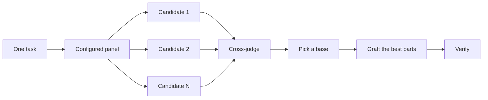

# 코드 작성 전에 설계하기

어려운 설계에 대한 하나의 시도는 모델이 생각한 첫 번째 형태에 고정됩니다. `/architect`는 구현 전에 타입과 경계를 정합니다. `/arena`는 동일한 브리프에 대한 여러 시도를 실행하고 최고의 부분을 병합합니다. `/interrogate`는 다른 모델들이 결과를 깨뜨리려고 시도합니다. 작업이 설계 합성이 아니라 커버리지일 때, `/swarm`은 슬라이스나 레이스를 펼치고 결과를 집계합니다.

가장 흔한 두 가지 설계 실수는 에이전트의 첫 번째 설계를 받아들이고 코드가 테스트하지 않은 계획을 다듬는 것입니다. 이 페이지는 둘 다 수정합니다. 코드를 통해 계획합니다. 프로토타입은 미해결 질문에 답하고, README 또는 튜토리얼은 목표를 설정하고, 서면 계획은 마지막에 나옵니다.


## `/architect`로 형태 정하기

```text
/architect design the import pipeline before writing any code. i care most about how callers use it.
```

[`/architect`](../../skills/architect/SKILL.md)는 먼저 자신을 근거로 삼으며, 설계가 건드리는 코드 위에서 `/how`를 실행하고 소유권이나 레이어를 이동할 때 `/why`를 실행합니다. 그런 다음 `/arena`를 실행하여 경쟁하는 설계 스케치를 생성하며, 각각에서 호출자의 사용법이 먼저 작성되고, 그 다음 타입, 시그니처, 모듈 맵이 따릅니다.

기본적으로 합성된 설계에서 바로 구현으로 진행합니다. 먼저 설계를 보고 싶다면, 말하세요:

```text
/architect with checkpoint. stop and show me before implementing.
```

코드가 시작되면 설계는 신성하지 않습니다. 구현이 관련 없는 곳에서 동일한 회피책을 보이거나, `any` 또는 강제 캐스트로만 컴파일되는 타입을 보이면, `/architect`는 그것을 설계가 잘못되었다는 증거로 취급합니다. 주변에 패치하는 대신 스케치를 폐기하고 처음부터 다시 시작합니다.

## `/arena`로 시도 펼치기

```text
/arena take my prompt to the arena verbatim. i want to compare their proposals with yours.
```

[`/arena`](../../skills/arena/SKILL.md)는 그 아래의 일반 도구입니다. N개의 서브에이전트가 동일한 설계 또는 코드 브리프를 병렬로 시도하며, 각각은 자체 워크트리 또는 디렉토리에 작성합니다. 다른 모델 패밀리의 읽기 전용 판사가 루브릭에 대해 모든 후보를 점수 매깁니다. 다른 패밀리의 모델이 실행될 수 없을 때, 코디네이터는 판사를 건너뛰고 베이스 자체를 선택합니다. 코디네이터는 각 후보를 끝까지 읽고, 베이스를 선택하고, 패배자의 최고 아이디어를 이식하고, 결과를 검증합니다.



패널은 [`/setup-pstack`](../../skills/setup-pstack/SKILL.md) 구성에서 나오며, 작업당 조정할 수 있습니다. 결정이 중요할 때 더 많은 후보를, 그렇지 않을 때 더 적은 후보를 요청하세요:

```text
/arena this, 5 candidates. the cache key format is expensive to change later.
```

## `/swarm`으로 슬라이스와 레이스 커버

```text
/swarm check every package under packages/ against its check.sh. one worker per package. one report.
```

[`/swarm`](../../skills/swarm/SKILL.md)는 독립적인 슬라이스, 커버리지 매트릭스, gauntlet 레인, 탐색 파티션 또는 선언된 레이스 암에 걸쳐 N개의 워커를 펼칩니다. 각 워커는 자체 스코프와 체크를 가져오고, `PASS`, `ISSUES` 또는 `BLOCKED`를 보고합니다. 부모는 워커를 기다리고 간격이나 드롭아웃이 있는 하나의 컴팩트한 보고서를 반환합니다.

병렬성이 커버리지를 사거나 독립적인 체크가 레이스할 수 있을 때 사용하세요. `/arena`는 모든 워커에게 동일한 설계 또는 코드 브리프를 주고, 베이스를 선택하고 최고의 부분을 이식합니다. `/swarm`은 슬라이스를 커버하거나 미리 선언된 선택 규칙으로 레이스를 실행합니다. 베이스 선택과 이식 의식을 사용하지 않습니다.

## `/interrogate`로 깨뜨리기

```text
/interrogate the whole branch, but skeptically. no nitpicks unless it's an actual bug or regression.
```

[`/interrogate`](../../skills/interrogate/SKILL.md)는 변경과 그 의도를 구성된 모델의 적대자에게 주고, 각각은 실제 코드에 대한 실행으로 그것을 깨뜨리려고 시도합니다. 적대자는 다른 실패를 찾습니다. 발견은 명령을 재실행하는 것이 의도를 깨뜨리는 실패를 보여줄 때만 살아남습니다. 보고서는 그것을 찾은 적대자와 함께 검증된 모든 발견을 나열하고, 각 적대자가 삭제한 것과 이유를 나열하고, 아무것도 적용하지 않습니다.

Dropped 리스트도 읽으세요. 판결을 오버라이드할 수 있습니다.

## 토론 대신 프로토타입

첫 번째 설계를 절대 받아들이지 마세요. 몇 개를 요청하고, 볼 수 있는 증거에서 선택하세요:

```text
/poteto-mode prototype a few options for the new dropdown menu. take screenshots or videos for me to compare.
```

[Prototype 플레이북](../../skills/poteto-mode/playbooks/prototype.md)은 스크래치 디렉토리에 일회용 스케치를 만들고, 변형을 하나의 스위처 뒤에 두고, 각각을 구동하고, 스크린샷이나 타이밍을 캡처합니다. UI뿐만 아니라 동작과 알고리즘에도 작동합니다. 프로토타입은 코드로 계획하는 것입니다. 에이전트가 당신에게 물어보는 대신 무언가를 실행하여 자신의 미해결 질문에 답할 수 있게 하고, 당신이 생각하지 못했을 옵션을 위한 여지를 남깁니다.

동일한 아이디어가 실제 설계로 확장됩니다. `/architect`를 프로토타입과 페어링하고 리뷰 게이트를 유지하세요:

```text
/poteto-mode we need rate limiting for external webhooks. /architect it first, and answer open questions with prototypes. let me review before proceeding.
```

추상 계획에 적대자를 소비하지 마세요. `/interrogate`는 실행이 증명하지 않는 모든 발견을 삭제하므로, 뒤에 코드가 없는 계획은 깨뜨릴 것이 거의 없습니다. 프로토타입이 질문을 해결하도록 한 다음, 구축된 것을 검토하세요.

## 공유 코드를 위해 README를 먼저 작성

다른 코드가 사용할 패키지나 API의 경우, 사용자가 읽을 문서로 시작하세요:

```text
/poteto-mode write a tutorial for how i would use the new config package first. then /teach me why it beats the current one.
```

튜토리얼을 먼저 작성하면 호출자의 관점을 강제합니다. 가상의 사용자에게 API를 설명하고 구현으로 다시 작업합니다. 문서는 또한 에이전트가 자신의 작업을 확인하는 구체적인 목표가 됩니다. 문서 자체가 중요할 때 [`/technical-writing`](../../skills/technical-writing/SKILL.md)를 명명하여, 튜토리얼이 한 번에 참조와 설명으로 표류하는 대신 튜토리얼로 유지되도록 하세요.

## 설계가 정해진 후 계획

pstack에는 의도적으로 계획 스킬이 없습니다. 서면 계획을 원할 때, 설계가 정해진 후에 요청하세요:

```text
/poteto-mode turn this design into a plan. small verifiable PRs, each with its own verification steps.
```

[Multi-phase plan 플레이북](../../skills/poteto-mode/playbooks/multi-phase-plan.md)은 프로토타입으로 남은 미해결 질문을 해결한 다음, PR당 하나의 섹션을 작성하며, 각각은 변경이 작동한다는 증거로 끝납니다. 통과하는 테스트 스위트만으로는 그 증거로 충분하지 않습니다. 계획이 결과물입니다. 플레이북은 그것을 구현하지 않으며, 다음에 어떤 실행 플레이북이 실행해야 하는지 명명합니다.

마이그레이션의 경우, 프롬프트에 기준을 명시하세요:

```text
/poteto-mode plan the migration of our ui library to the new styling system. small verifiable PRs, each with visual regression checks. the result must match the original exactly, bugs included.
```

"bugs included"는 마이그레이션이 가는 길에 조용히 것을 수정하지 않도록 유지하며, 그렇지 않으면 이전과 새 출력을 비교하는 것이 불가능해집니다. 여러 날에 걸친 프로젝트의 경우, 다른 에이전트가 진행 중인 작업을 볼 수 있도록 잠시 계획을 리포에 커밋할 수 있습니다. 작업이 끝나면 삭제하세요.

## 작업이 얼마나 많은 설계 작업을 받을 자격이 있나요?

모든 변경이 이것을 필요로 하는지 궁금할 수 있습니다. 아니요. 대부분의 변경은 이것 중 아무것도 필요하지 않습니다. 대략적인 사다리:

- 확신이 없는 작고 완성된 변경은 `/interrogate`만 필요합니다.
- 함수 경계를 넘거나 소유권을 이동하는 변경은 `/architect`를 받을 자격이 있으며, 이는 `/arena`를 함께 가져옵니다.
- 이름 지정, 형식 또는 알고리즘과 같이 독립적인 시도가 도움이 될 독립 실행형 결정은 `/arena`를 직접 사용합니다.
- 커버리지 매트릭스, 병렬 체크 세트 또는 선언된 암이 있는 레이스는 `/swarm`입니다.
- 레이아웃, 타이밍 또는 접근 방식과 같이 무언가를 실행하여 답할 수 있는 미해결 질문은 토론이 아니라 프로토타입을 얻습니다.
- 되돌리기가 비싼 논쟁이 있는 설계는 `/architect`를 얻고, 배포 전에 `/interrogate`를 얻습니다.
- 여러 PR에 걸친 작업은 설계가 정해진 후 작성된 계획을 얻습니다.

`/poteto-mode`는 이미 이 사다리를 적용합니다. 경계를 넘는 작업은 자체적으로 `/architect`를 트리거하므로, 기본값보다 더 많거나 적은 scrutiny를 원할 때 주로 이것들을 직접 사용합니다.

다음: [변경 빌드 및 정리](./05-build-and-clean.md).
