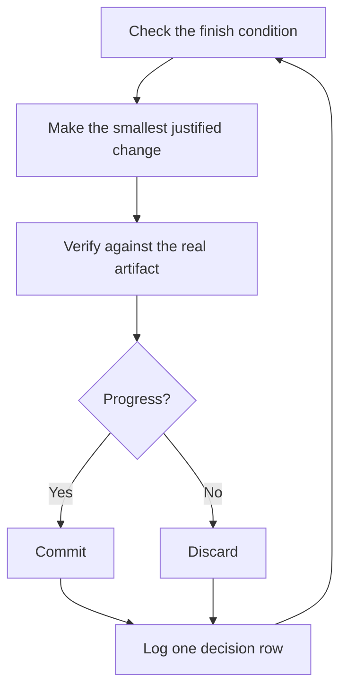

# 수면 중 작업 실행

이것은 그 전 모든 것에 대한 보상입니다. 자신의 작업을 검증할 수 있다고 신뢰할 수 있는 에이전트는 어려운 작업과 함께 혼자 남겨둘 수 있는 에이전트입니다. 그것을 안전하게 만드는 것은 희망이 아닙니다. 확인 가능한 완료 조건, 격리된 워크트리 또는 클라우드 에이전트, 그리고 아침에 감사하는 의사결정 로그입니다.


## 루프 전에 신뢰 얻기

신뢰하지 않는 루프는 그저 확인되지 않은 작업을 더 빠르게 생산하며, 혼란은 매 반복마다 복합됩니다. 하나를 실행하도록 남겨두기 전에, 그것이 얻었는지 확인하세요:

- 손으로 작업을 한 번 수행했거나, 에이전트가 하는 것을 관찰하여, 좋은 것이 어떻게 보이는지 압니다.
- 에이전트가 당신이 직접 사용할 도구와 신호를 가지고 있습니다: 검증 스킬, 프로파일러, 로그.
- 모든 단계는 작업을 증명하고 작업이 기준을 놓칠 때 라인을 멈출 수 있습니다.
- 몇 개의 transcript를 읽고 반복된 실패를 도구, 스킬 또는 체크로 바꿨습니다.

네 가지 모두 유지된 후에만 루프를 자율적으로 만드세요. 그 전까지는 관찰하면서 실행하세요.

## 야간 계약

좋은 핸드오프는 목표, 완료 조건, 권한, 탈출구를 가집니다. 길 필요가 없습니다:

```text
/poteto-mode im going to bed. migrate every caller to the new parser in a fresh worktree off <base>.
done means zero old callers, all parser fixtures pass, old api deleted.
keep a decision log. don't ask me before committing.
/loop until done. if you're truly stuck after a few hours, stop and write up why.
```

각 라인이 무엇을 사는지 살펴보세요:

- "im going to bed"는 세션 오버라이드입니다. 에이전트는 질문을 멈추고 계속 진행합니다.
- "done means..."는 목표를 모든 반복이 실행할 수 있는 체크로 바꿉니다.
- "fresh worktree off `<base>`"는 실행이 열려 있는 다른 것과 충돌하지 않도록 유지합니다.
- "don't ask me before committing"은 에이전트가 그렇지 않으면 차단할 권한을 미리 답합니다.
- `/loop`는 pstack 스킬이 아니라 Cursor의 내장 웨이크 메커니즘입니다. [Autonomous run 플레이북](../../skills/poteto-mode/playbooks/autonomous-run.md)은 이벤트나 하트비트에서 완료 조건을 재확인하는 데 사용합니다.
- 탈출구는 진짜 막다른 골목에서 멈추고 이유를 기록하도록 하며, 이는 8시간의 창의적 목표 재해석보다 낫습니다.

물러난 후 이 작업을 검토할 것이므로, `/poteto-mode`는 [`/figure-it-out`](../../skills/figure-it-out/SKILL.md)을 통해 라우팅하며, 이는 코드 전에 실행의 단계를 설계하고 의사결정 로그를 연결합니다.

의도적으로 실행을 중지하려면, 에이전트에게 일시 중지하거나 오프라인으로 가거나 Cursor를 재시작하려고 한다고 말하세요. [Pause safely 플레이북](../../skills/poteto-mode/playbooks/pause-safely.md)은 현재 단계를 완료하거나 후퇴하고, work-in-progress 체크포인트를 커밋하고, 재개 노트를 작성합니다. 새로운 채팅은 Session pickup 플레이북을 통해 그 노트에서 작업을 픽업합니다. "keep going"이라고 말하는 것은 절대 일시 중지를 트리거하지 않습니다.

## 루프가 밤새 하는 것



하나의 변경, 하나의 체크, 하나의 로그 행, 매 반복. 도움이 되지 않은 변경은 버려지며, 계속 유지되지 않습니다. 고원은 멈춤이 아니라 피봇을 의미하며, 완료 조건은 승리를 선언하기 위해 조용히 완화되지 않습니다.

## 아침 감사

[`/show-me-your-work`](../../skills/show-me-your-work/SKILL.md)는 실행을 검토 가능하게 만드는 것입니다. 각 행은 시간, 단계, 결정, 이유, 증거 포인터, 결과를 `decisions.tsv`(또는 여러 실행이 디렉토리를 공유할 때 `.audit/<task-slug>.tsv`)의 TSV에 기록합니다. 기본적으로 로컬에 유지됩니다. 리뷰어가 결과를 신뢰하기 위해 추적이 필요할 정도로 작업이 야심찬 경우 커밋하세요.

돌아왔을 때, 실행을 검토 형식으로 요청하세요:

```text
/show-me-your-work catch me up on what you did last night
```

스킬이 요약을 돌려주기 전에, 추적과 transcript를 읽기 위해 다른 모델 패밀리에 리뷰어를 생성하고, 답변은 주목할 만한 것을 나열하는 Attention 섹션으로 끝납니다. 그 섹션을 먼저 읽고, 그것이 가리키는 로그 행을 읽으세요. 밤 전체를 다시 읽는 것이 아니라 결정을 감사하는 것입니다.

감사 대신 빠른 상태를 원하면, 작업을 실행한 채팅에서 [`/ketchup`](../../skills/ketchup/SKILL.md)를 실행하세요. 읽기만 하고, 마지막 메시지 이후 변경된 것을 작업이 생산한 스크린샷과 작은 다이어그램과 함께 명확한 단어로 알려줍니다. 그런 다음 병합, 승인 또는 옵션 간 선택과 같이 기다리고 있는 각 호출을 선택, 증거, 위험과 함께 나열하여, 답변만으로 결정할 수 있습니다.

## 밤이 작업이 아니라 큐를 보유할 때

위의 계약은 하나의 작업을 하나의 완료 조건으로 구동합니다. 일부 밤은 더 많은 것을 보유하며, 독립적인 변경의 큐 또는 전체 프로그램입니다. 세 가지 플레이북이 동일한 신뢰를 확장합니다.

[Autopilot-full](../../skills/poteto-mode/playbooks/autopilot-full.md)은 독립적인 PR의 큐를 병합까지 실행합니다. 각 PR은 빌드부터 병합까지 운반하는 하나의 소유자 에이전트를 얻으며, 어떤 소유자도 자체 판결로 병합하지 않습니다. 새로운 검증기 스웜이 소유자의 코드 준비 헤드를 확인합니다. 나중 리베이스나 사소한 수정은 하나의 새로운 검증기를 얻고, 새 동작이나 큰 새 diff만 전체 스웜을 다시 호출합니다. 병합하는 패치에 대한 깨끗한 판결만 병합을 승인합니다:

```text
/poteto-mode full autopilot on this queue. each item is independent. i want them merged by morning.
```

[Autopilot-stack](../../skills/poteto-mode/playbooks/autopilot-stack.md)는 병합 없는 Autopilot-full입니다. 검증된 PR로 깨어나며, 각각은 판결과 함께 있고, 직접 검토하고 착지시킵니다. PR은 빌드되는 PR 위에만 스택됩니다. 병합하기 전에 작업에 자신의 눈을 원할 때 Autopilot-full보다 선택하세요:

```text
/poteto-mode autopilot these five changes, but don't merge. i'll land them in the morning.
```

[Orchestrate](../../skills/poteto-mode/playbooks/orchestrate.md)는 단일 에이전트를 넘어 생존하는 프로그램을 위한 것입니다: 여러 날, 많은 스택된 PR, 하나의 지속적인 코디네이터 채팅 아래의 서브에이전트 함대. 코디네이터는 어떤 에이전트가 각 작업 조각을 수행할지 결정하고, 각각이 생산하는 것을 확인하고, 결코 직접 코드를 작성하지 않습니다. 한 에이전트가 세션에서 작업을 완료할 수 있다면, 플레이북 자체는 위의 야간 계약으로 다시 라우팅합니다:

```text
/poteto-mode orchestrate the store migration. own it until every package is converted and merged. i'll check in twice a day.
```

## 많은 프로젝트를 병렬로 실행

[Cursor 프로젝트](https://cursor.com/blog/projects)는 하나의 코디네이터 에이전트에게 지속적인 스레드를 제공합니다. 코디네이터는 코드를 작성하지 않습니다. 기본적으로 클라우드에서 실행되는 서브에이전트를 지시하므로, 노트북이 닫혀 있을 때 작업이 계속됩니다. 그것이 Orchestrate 플레이북이 예상하는 형태입니다. 코디네이터에 대한 프롬프트를 `/poteto-mode`로 시작하면, 생성하는 서브에이전트가 플레이북을 따릅니다.

몇 가지 습관이 도움이 됩니다:

- 기능, 마이그레이션, 성능 푸시 또는 기술 부채 정리와 같이 각 작업 본문에 자체 프로젝트를 제공하세요. 여러 개가 나란히 실행될 수 있습니다.
- 관련 채팅을 프로젝트로 드래그하세요, 완료된 것을 포함하여. 그것들은 그 안의 모든 에이전트를 위한 컨텍스트가 됩니다.
- 병합하기 전에 각 PR에 검증 스웜을 제공하고, Autopilot-stack 또는 Autopilot-full이 큐를 운반하도록 하세요.
- 데이터로 뒷받침된 계획을 코디네이터에게 요청하고, 물어보기 전에 프로토타입으로 미해결 질문에 답하도록 하세요.

하나의 프롬프트가 연구부터 실행까지 전체 프로젝트를 운반할 수 있습니다:

```text
/poteto-mode refactor this repo so its architecture is more agent friendly. use /correct and /architect on past commits and review comments to find the mistakes agents make most here. use /recall for context from past chats. answer open questions with prototypes instead of asking me. come back with a plan backed by real data. once i approve it, run it with autopilot-stack or autopilot-full, and ask me which.
```

## 루프가 스스로 시작하도록 허용

위의 모든 루프는 여전히 시작하기 위해 기다립니다. 예약되거나 이벤트 주도 자동화는 그 단계를 제거합니다. 소프트웨어 유지보수는 이것에 잘 맞는 단계로 나뉩니다: 보고서를 분류하고, 재현하고, 수정하고, 수정을 검증. 두 가지 규칙이 그러한 라인을 신뢰할 수 있게 유지합니다:

- 모든 단계는 라인을 멈출 수 있습니다. 분류는 보고서가 예상된 동작이라고 결정할 수 있고, 재현은 재현하는 데 실패할 수 있고, 수정자는 변경이 너무 위험하다고 판단할 수 있습니다. 이러한 각 결과는 유용한데, 나쁜 작업이 다음 단계에 도달하지 않도록 하기 때문이며, 거기서 실행 취소하는 데 더 많은 비용이 듭니다.
- 모든 단계는 증거를 전달합니다. 재현은 손상된 상태의 스크린샷과 비디오를 첨부하고, 수정은 전후 증거를 첨부합니다. 그러면 사람은 코드 라인을 읽기 전에 에이전트가 올바른 것을 수정했는지 확인할 수 있습니다.

pstack은 이것을 Slack 이슈 보고서를 위한 휴면 [자동화 팩](../../automations/benny/README.md)으로 제공합니다. 하나의 자동화가 각 보고서를 분류합니다. 다른 것은 확인된 버그를 재현하고 작은 초안 수정을 준비할 수 있습니다. 에이전트를 [`FOR_AGENTS.md`](../../automations/benny/FOR_AGENTS.md)로 가리키고 대상 리포지토리를 명명하여 설정하세요.

**함정:** 지속 시간은 완료 조건이 아닙니다. "4시간 동안 이 작업을 수행"은 에이전트에게 확인할 것을 제공하지 않으며, 결과 대신 4시간의 움직임으로 깨어날 것입니다. `/loop`에 통과하거나 실패할 수 있는 술어를 제공하세요.

다음: [원칙 이름으로 조향](./08-principles.md).
